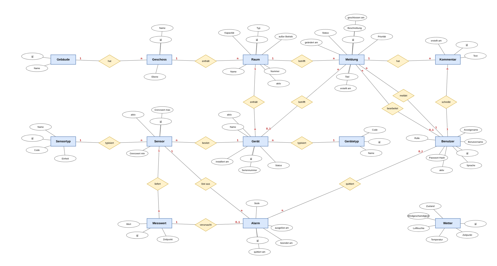
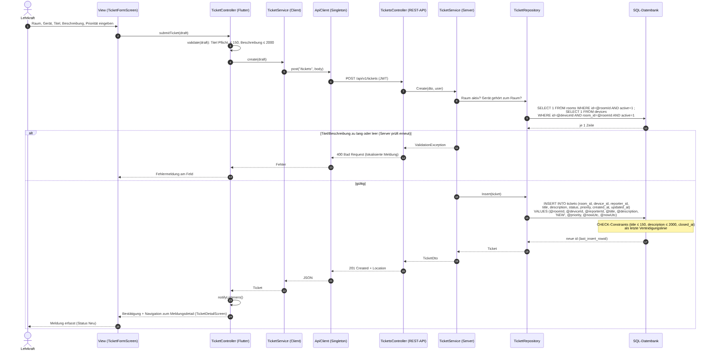

# Datenbank – Smart School Service Hub (Meilenstein 2)

Dateien: [schema.sql](schema.sql) (Tabellen, Constraints, View) und [seed.sql](seed.sql) (Beispieldaten). Das Schema läuft in SQLite. Anlegen der Datenbank:

```
sqlite3 hub.db < schema.sql
sqlite3 hub.db < seed.sql
```

## 1 ER-Modell



Das Diagramm ist in der Chen-Notation gezeichnet: Rechtecke sind Entitäten, Rauten Beziehungen, Ovale Attribute (unterstrichen = Primärschlüssel). Die Datei `er_modell.drawio` lässt sich mit draw.io öffnen und bearbeiten. Fremdschlüssel sind als Beziehungen dargestellt und tauchen deshalb nicht als Attribute auf. Die Spalte `alarms.room_id` ist eine bewusste Redundanz (Raum ergibt sich aus Sensor und Gerät) und im ER-Modell nicht eingezeichnet. Die wichtigsten Kardinalitäten:

- **Gebäude 1 : n Geschoss** und **Geschoss 1 : n Raum**: ein Gebäude hat mindestens ein Geschoss, ein Geschoss beliebig viele Räume.
- **Raum 1 : n Gerät**, **Gerätetyp 1 : n Gerät**, **Gerät 1 : n Sensor**, **Sensor 1 : n Messwert**.
- **Raum 1 : n Meldung**; ein Gerät ist bei der Meldung optional (0..1), eine Meldung betrifft aber immer einen Raum.
- **Benutzer 1 : n Meldung** als Melder (Pflicht) und 0..1 : n als Bearbeiter (optional).
- **Meldung 1 : n Kommentar**, **Benutzer 1 : n Kommentar**.
- **Sensor 1 : n Alarm**, es darf aber höchstens ein Alarm je Sensor aktiv sein; ein Messwert löst höchstens einen Alarm aus (0..1).
- `weather_snapshots` hat bewusst keine Beziehung (reine Zeitreihe des Außenwetters).

Es gibt keine n:m-Beziehungen, daher keine Zuordnungstabellen.

## 2 Relationenmodell

Notation: `Tabelle(PK, Attribut, FK → Tabelle)`, `UK` = eindeutig, `?` = optional.

```
users(             id, username UK, display_name, password_hash, role, locale, active)
buildings(         id, name UK)
floors(            id, building_id → buildings, level, name)                 UK(building_id, level)
rooms(             id, floor_id → floors, number, name, type, capacity?, out_of_order, active)
                                                                             UK(floor_id, number)
device_types(      id, code UK, name)
devices(           id, room_id → rooms, device_type_id → device_types, name,
                   serial_number? UK, status, installed_at?, active)
sensor_types(      id, code UK, name, unit)
sensors(           id, device_id → devices, sensor_type_id → sensor_types,
                   min_threshold?, max_threshold?, active)
sensor_readings(   id, sensor_id → sensors, value, measured_at)              UK(sensor_id, measured_at)
tickets(           id, room_id → rooms, device_id? → devices, reporter_id → users,
                   assignee_id? → users, title, description?, status, priority,
                   created_at, updated_at, closed_at?)
ticket_comments(   id, ticket_id → tickets, author_id → users, text, created_at)
alarms(            id, sensor_id → sensors, reading_id → sensor_readings UK, room_id → rooms,
                   level, raised_at, acknowledged_by? → users, acknowledged_at?, cleared_at?)
weather_snapshots( id, fetched_at UK, temperature, humidity?, wind_speed?, condition)
v_room_status(     room_id, status)                                          -- View, nicht gespeichert
```

## 3 Normalisierung und Entwurfsentscheidungen

Das Modell ist in der 3. Normalform: alle Attribute sind atomar, alle Primärschlüssel bestehen aus einer Spalte (`id`), und Angaben wie Gerätetyp, Einheit oder Gebäudename stehen nur in ihrer eigenen Tabelle. Einzige bewusste Abweichung ist `alarms.room_id`, das sich auch über Sensor und Gerät ableiten ließe; es wird gespeichert, damit das Dashboard Alarme je Raum ohne mehrfachen Join lesen kann.

Der Raumstatus wird nicht gespeichert, sondern in der View `v_room_status` aus Alarmen, offenen Meldungen und Sensoren berechnet (Reihenfolge: OUT_OF_ORDER, ALARM, WARNING, UNKNOWN, OK). So kann er nie von den echten Daten abweichen. Nur das Sperr-Flag `rooms.out_of_order` wird manuell gesetzt.

`DeviceType` und `SensorType` sind eigene Tabellen statt Enums, damit neue Gerätetypen und Messgrößen per `INSERT` ohne Codeänderung hinzukommen. Feste Werte wie Rolle, Status und Priorität sind per `CHECK` abgesichert. Benutzer, Räume, Geräte und Sensoren werden nicht gelöscht, sondern über `active` deaktiviert, damit die Meldungshistorie erhalten bleibt. Ein Unique-Index sorgt dafür, dass pro Sensor nur ein aktiver Alarm existiert.

## 4 Kommunikation GUI → Controller → DB → Controller → GUI



Ablauf am Beispiel „Meldung anlegen“:

1. Die Lehrkraft füllt im `TicketFormScreen` Raum, Gerät, Titel, Beschreibung und Priorität aus und sendet das Formular ab.
2. Der `TicketController` (Client) prüft die Eingaben (Titel höchstens 150, Beschreibung höchstens 2000 Zeichen).
3. Der `TicketService` übergibt an den `ApiClient`, dieser sendet `POST /api/v1/tickets` mit dem JWT im Header.
4. Der `TicketsController` (Server) prüft Token und Rolle und ruft den `TicketService` auf.
5. Der Server-`TicketService` prüft über das `TicketRepository`, ob Raum und Gerät zusammenpassen:
   `SELECT 1 FROM rooms WHERE id=@roomId AND active=1;` und `SELECT 1 FROM devices WHERE id=@deviceId AND room_id=@roomId AND active=1;`
6. Bei gültigen Daten setzt der Service Status `NEW` und die Zeitstempel und fügt die Meldung ein:
   `INSERT INTO tickets (room_id, device_id, reporter_id, title, description, status, priority, created_at, updated_at) VALUES (...);`
7. Die Datenbank liefert die neue `id`, Repository und Service bauen daraus ein `TicketDto`.
8. Der `TicketsController` antwortet mit `201 Created` und dem JSON der Meldung.
9. `ApiClient` und `TicketService` geben das Ticket an den `TicketController` zurück, dieser ruft `notifyListeners()` auf.
10. Die View zeigt die Bestätigung und wechselt zum Meldungsdetail. Bei ungültigen Eingaben liefert der Server `400`, und der Controller zeigt die Fehlermeldung am Feld an.
