# Mockups – Smart School Service Hub

Erster Entwurf der Oberfläche für Meilenstein 2 (UI/GUI). Alles ist normales HTML mit einer gemeinsamen `style.css`. Das kleine `script.js` macht nur die Umschalter oben (Rolle, Wetter, Alarm, Sprache) und die Geschossauswahl. Zum Ansehen reicht es, `index.html` im Browser zu öffnen.

## Dateien

| Datei | Inhalt |
|---|---|
| `index.html` | Login |
| `dashboard.html` | Kennzahlen, Wetter-Kachel, Alarmliste, Messwert-Anzeige, letzte Meldungen |
| `geschoss.html` | Grundriss mit Raumkacheln, Geschossauswahl EG / 1. OG / 2. OG, Raumdetail |
| `meldungen.html` | Meldungsliste mit Filter |
| `meldung_neu.html` | Formular Störung melden |
| `meldung_detail.html` | Status, Zuweisung, Kommentare |
| `verwaltung.html` | Räume und Geräte als Tabelle (nur Admin) |
| `style.css`, `script.js` | gemeinsames Design und Umschalter |

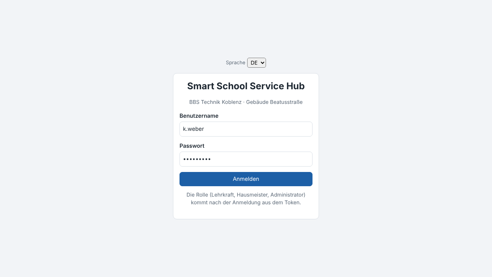
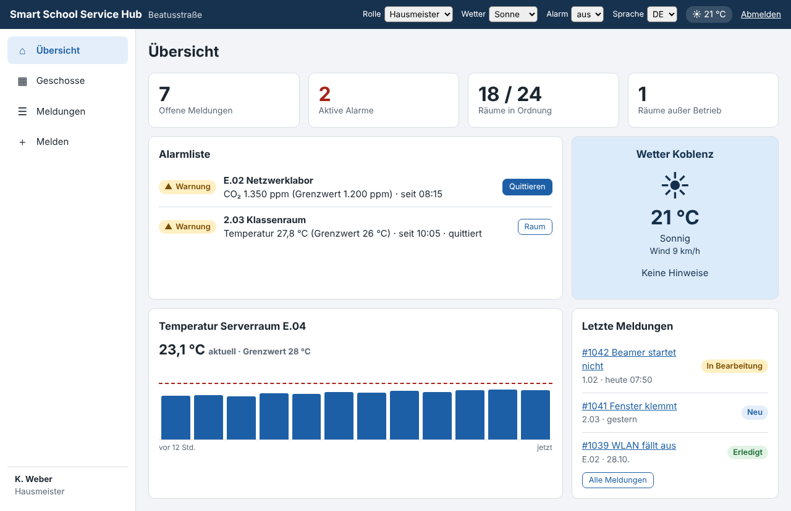
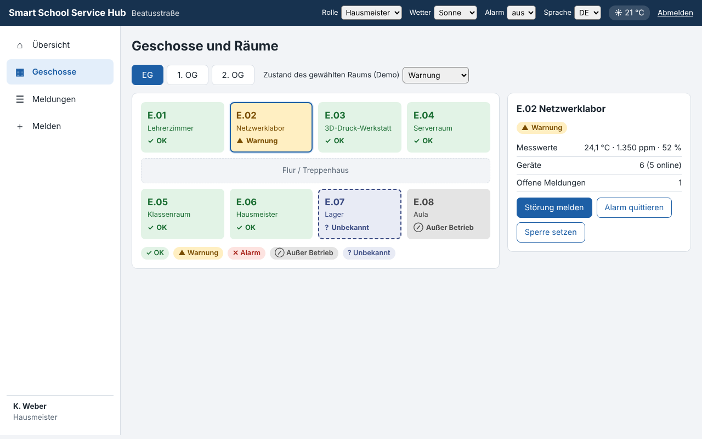
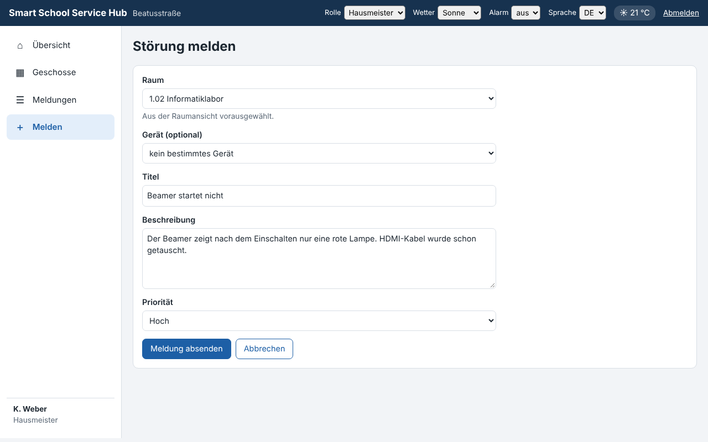
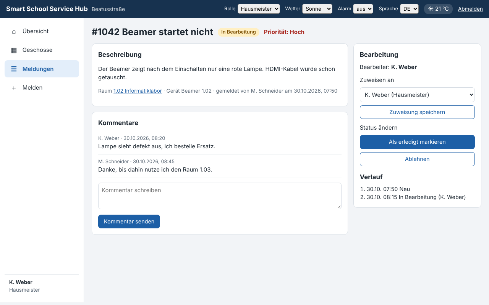
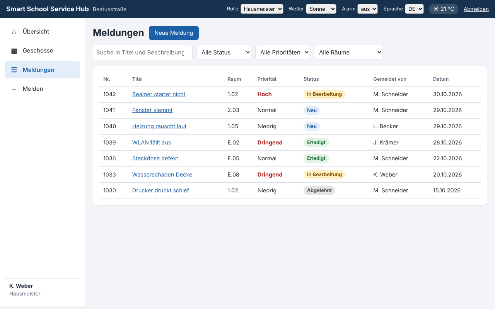

Ablauf zwischen den Seiten:

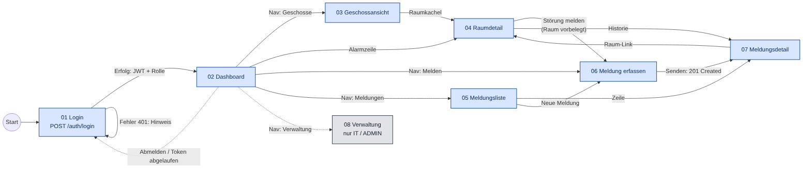

## Komponenten

### Dashboard

| Komponente | Funktion | Daten/REST-Aufruf |
|---|---|---|
| Kennzahl-Kacheln | offene Meldungen, aktive Alarme, Räume je Zustand | GET /dashboard/summary |
| Wetter-Kachel | Außenwetter mit Symbol und Hinweis (z. B. Fenster schließen) | GET /weather/current |
| Alarmliste | aktive Alarme, Quittieren-Button nur für Hausmeister/Admin | GET /alarms?active=true, POST /alarms/{id}/ack |
| Alarm-Banner | roter Balken oben bei Alarmstufe ALARM | GET /alarms?active=true |
| Messwert-Anzeige | Temperaturverlauf eines Sensors mit Grenzwertlinie | GET /sensors/{id}/readings |
| Letzte Meldungen | die drei neuesten Meldungen, Link zur Detailseite | GET /tickets |

### Geschossansicht

| Komponente | Funktion | Daten/REST-Aufruf |
|---|---|---|
| Geschossauswahl | wechselt zwischen EG, 1. OG und 2. OG | GET /buildings/{id}/floors |
| Raumkacheln | Raumnummer, Name und Zustand (Farbe, Symbol, Text) | GET /floors/{id}/rooms |
| Legende | erklärt die fünf Zustände | – |
| Raumdetail-Panel | Messwerte, Geräte, offene Meldungen des gewählten Raums | GET /rooms/{id}/status, /rooms/{id}/devices |
| Button „Störung melden“ | öffnet das Formular mit vorausgewähltem Raum | – (Link zu meldung_neu.html) |
| Button „Sperre setzen“ | Raum außer Betrieb nehmen oder wieder freigeben (Hausmeister/Admin) | PATCH /rooms/{id}/out-of-order |

### Meldung erfassen

| Komponente | Funktion | Daten/REST-Aufruf |
|---|---|---|
| Raumauswahl | Raum der Störung, kommt ggf. aus der Raumansicht | GET /floors/{id}/rooms |
| Geräteauswahl | optional ein Gerät aus dem Raum | GET /rooms/{id}/devices |
| Titel und Beschreibung | Freitext zur Störung | in POST /tickets |
| Priorität | Niedrig, Normal, Hoch, Dringend | in POST /tickets |
| Button „Meldung absenden“ | legt die Meldung an, danach Weiterleitung zur Detailseite | POST /tickets |
| Abbrechen | zurück zur Liste | – |

## Abhängigkeiten

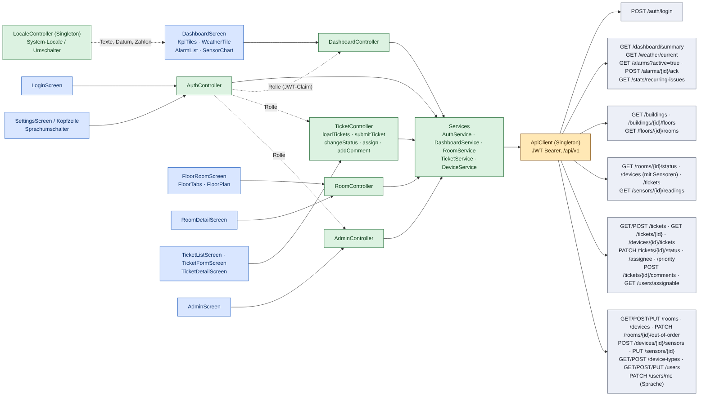

**Datenabhängigkeit**
- Dashboard-Kennzahlen kommen aus den Meldungen, Alarmen und Raumzuständen.
- Raumkacheln hängen an den Sensoren und offenen Meldungen eines Raums.
- Das Raumdetail-Panel braucht den gewählten Raum aus der Geschossansicht.
- Das Meldungsformular übernimmt Raum und Gerät aus dem Raumdetail.
- Das Wetter wird nur gelesen und ändert keine Raumdaten.

**Kommunikationsabhängigkeit**
- Die Seiten sprechen nur mit dem Controller, der Controller mit dem ApiClient, dieser mit der REST-API (JWT im Header).
- Dashboard und Alarmliste werden alle 15 s neu geladen, Raumansicht alle 30 s, Messwerte alle 60 s, Wetter alle 5 min.
- Nach „Quittieren“ oder „Absenden“ wird die Liste neu geladen.
- Die Sprache wird beim Umschalten im Benutzerprofil gespeichert (PATCH /users/me).

**Zustandsänderungen durch Alarme und Berechtigungen**
- Grenzwert überschritten: Raum wird Warnung, ab 5 % darüber Alarm, dazu erscheint das Banner.
- Alarm vorbei und nichts offen: Raum wieder OK.
- Quittieren ändert nur den Alarm, nicht den Raumzustand.
- Eine dringende offene Meldung setzt den Raum auf Warnung.
- Lehrkraft: sieht keine Buttons zum Quittieren, Zuweisen, Status ändern und Sperren, nur eigene Meldungen.
- Hausmeister: darf bearbeiten, zuweisen, quittieren und Räume sperren.
- Admin: zusätzlich Verwaltung und Wiedereröffnen erledigter Meldungen.

## Zustände

- **Wetter:** Sonne, Regen, Sturm, Schnee. Die Kachel ändert Symbol, Temperatur, Hintergrund und Hinweistext, in der Kopfzeile steht eine kurze Anzeige.
- **Geschoss:** EG, 1. OG, 2. OG, immer ein Geschoss sichtbar, der gewählte Raum ist markiert.
- **Raumzustände:** immer Farbe, Symbol und Text, damit es auch ohne Farbsehen geht.

| Zustand | Symbol | Darstellung |
|---|---|---|
| OK | ✓ | grün |
| Warnung | ▲ | gelb |
| Alarm | ✕ | rot, Banner oben |
| Außer Betrieb | ⊘ | grau schraffiert |
| Unbekannt | ? | blaugrau, gestrichelter Rand |

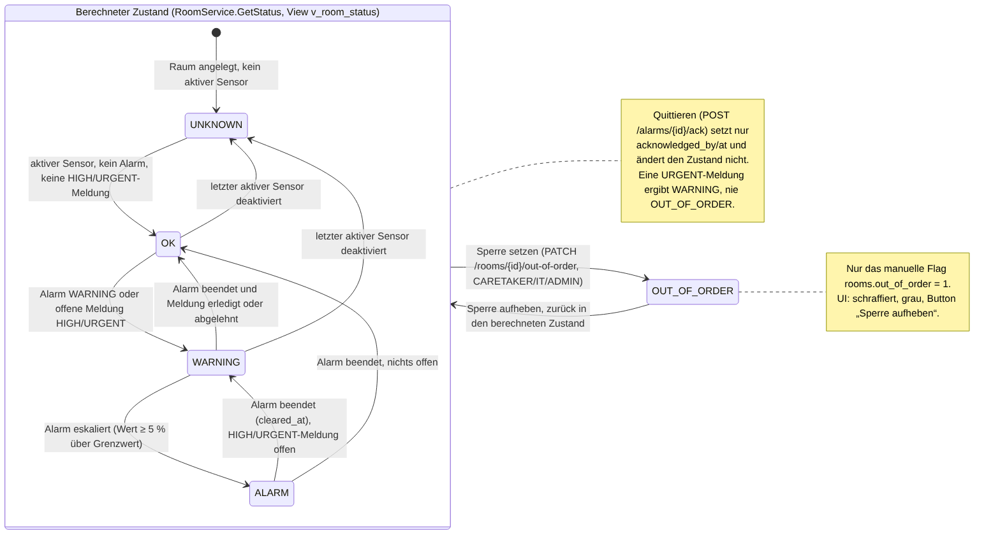

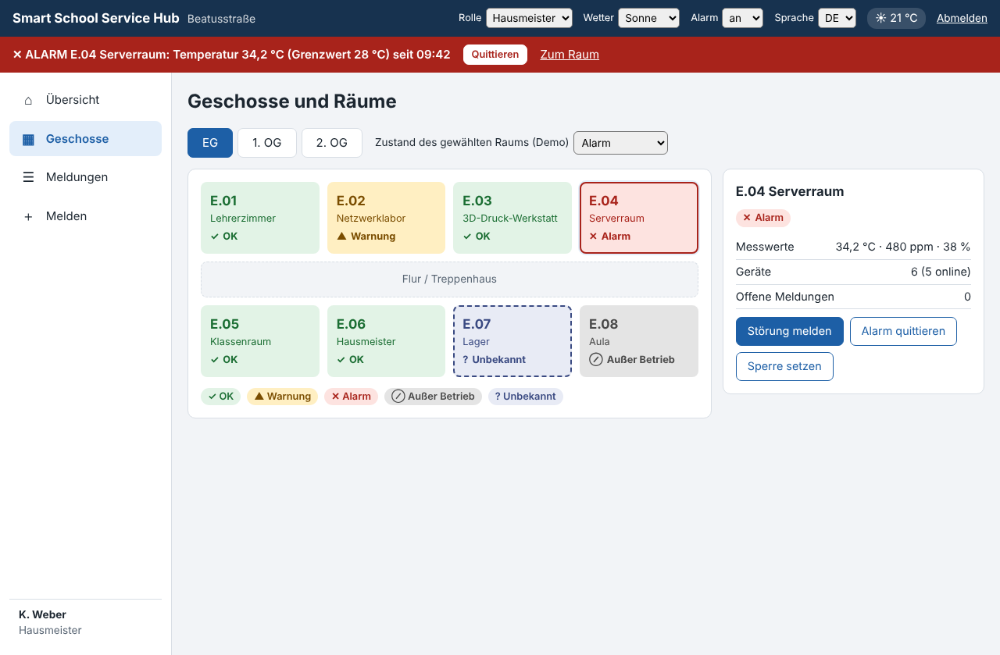

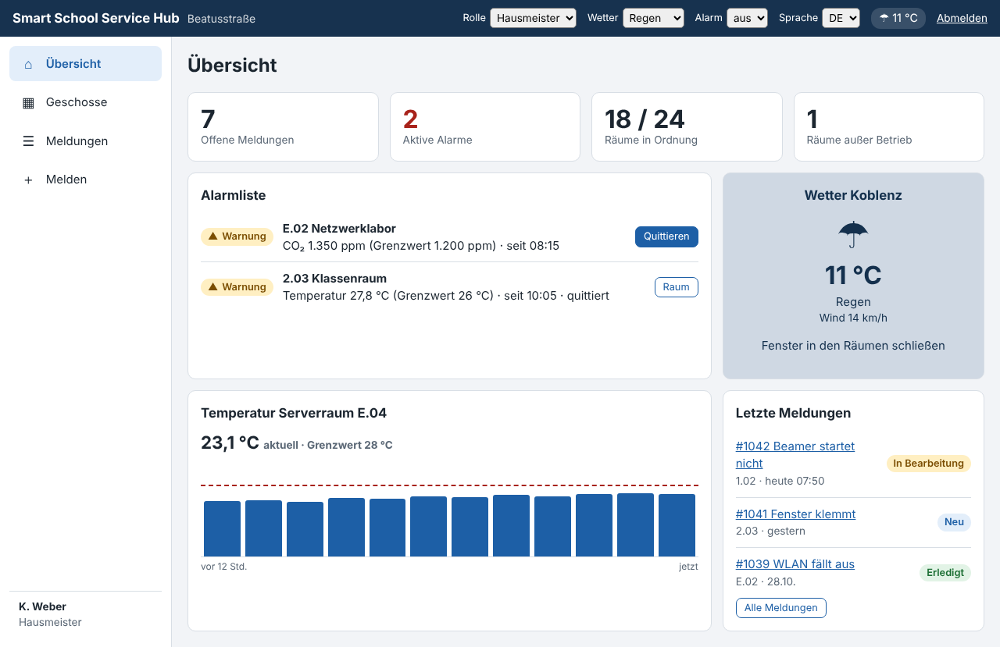

Mit den Umschaltern oben kann man alles ausprobieren. Sie werden im Browser gemerkt, damit sie beim Seitenwechsel bleiben. Die Sprache (DE/EN) ändert nur die Beschriftungen der Kopfzeile und der Navigation, der Rest soll später über die Sprach-Bundles kommen.

## Responsive und Betriebssystem

| Breite | Layout |
|---|---|
| über 1024 px (Desktop) | Navigation links mit Text, Dashboard in mehreren Spalten, Geschoss und Raumdetail nebeneinander |
| 600 bis 1024 px (Tablet) | Navigation links nur mit Symbolen, Karten untereinander, 2 Kennzahlen pro Zeile |
| unter 600 px (Smartphone) | Navigation als Leiste unten, eine Spalte, Raumkacheln zweispaltig, Tabellen blenden Nebenspalten aus |

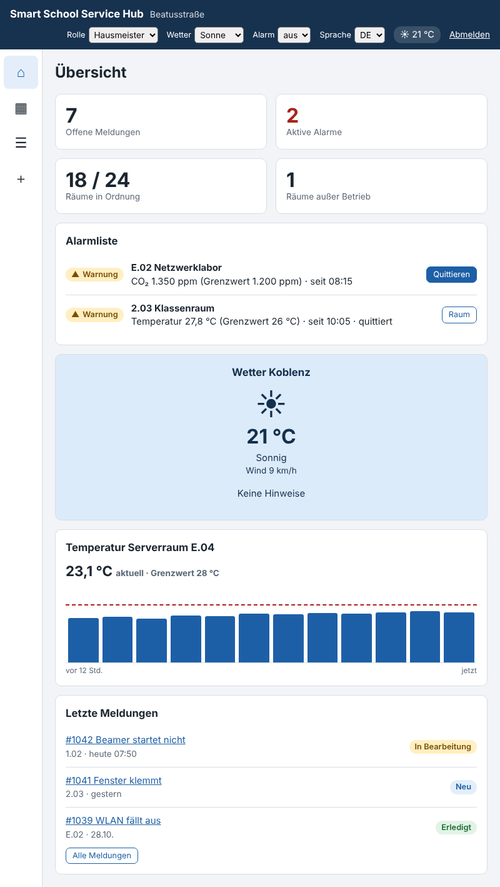
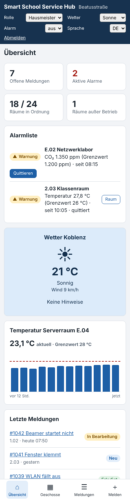

Umgesetzt mit Media Queries in `style.css`, ohne Framework und ohne externe Dateien.

Betriebssystem (für die Flutter-App, im Mockup nur angedeutet):
- Android, Windows und Web: Material 3
- iOS: Cupertino-Widgets
- Dunkles Design folgt dem System (`prefers-color-scheme: dark`, im CSS schon drin)
- Sprache und Datumsformat folgen der System-Locale, der Umschalter in der App überschreibt sie
