# UML-Diagramme – Smart School Service Hub (Meilenstein 2)

Dieses Verzeichnis enthält die UML-Diagramme für Client (Flutter) und Server (C#). Bezeichner in den Diagrammen sind englisch, die Beschreibungen deutsch.

## 1 Diagramme

### Klassendiagramme

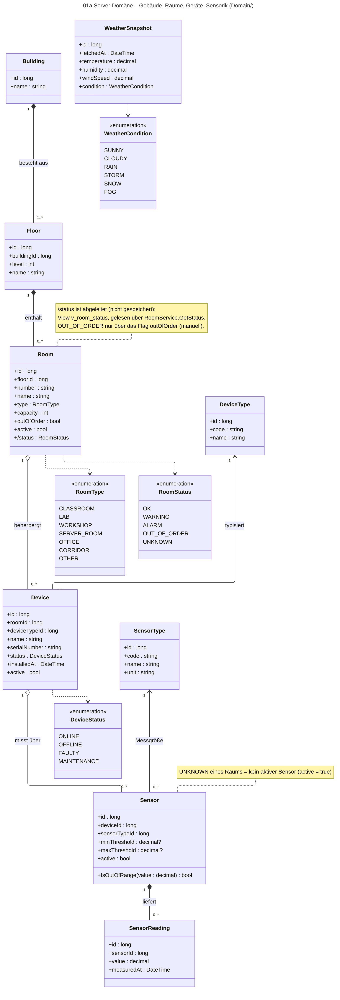

Server-Domäne: Gebäude, Geschosse, Räume, Geräte, Sensoren und Messwerte. Der Raumstatus (`/status`) ist abgeleitet und wird nicht gespeichert.

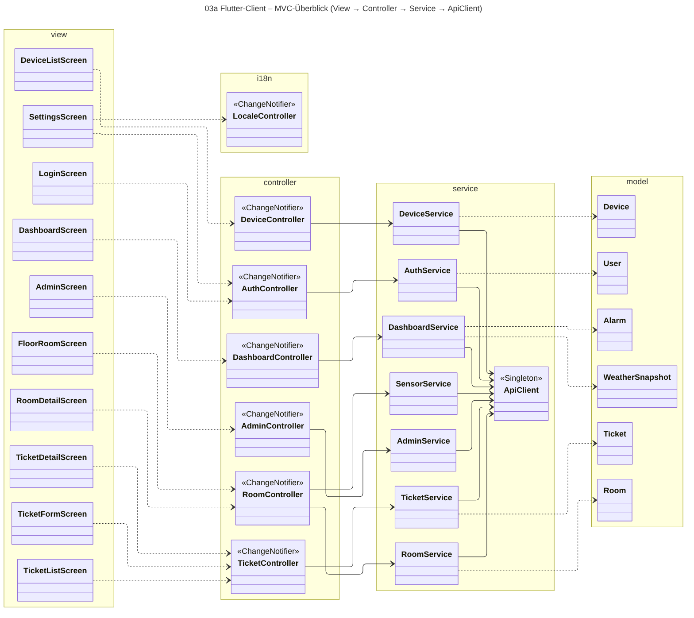

Client nach MVC: Views rufen Controller (`ChangeNotifier`) auf, diese nutzen Services und den `ApiClient`. Die Model-Klassen werden von den Services geliefert.

### Design-Patterns

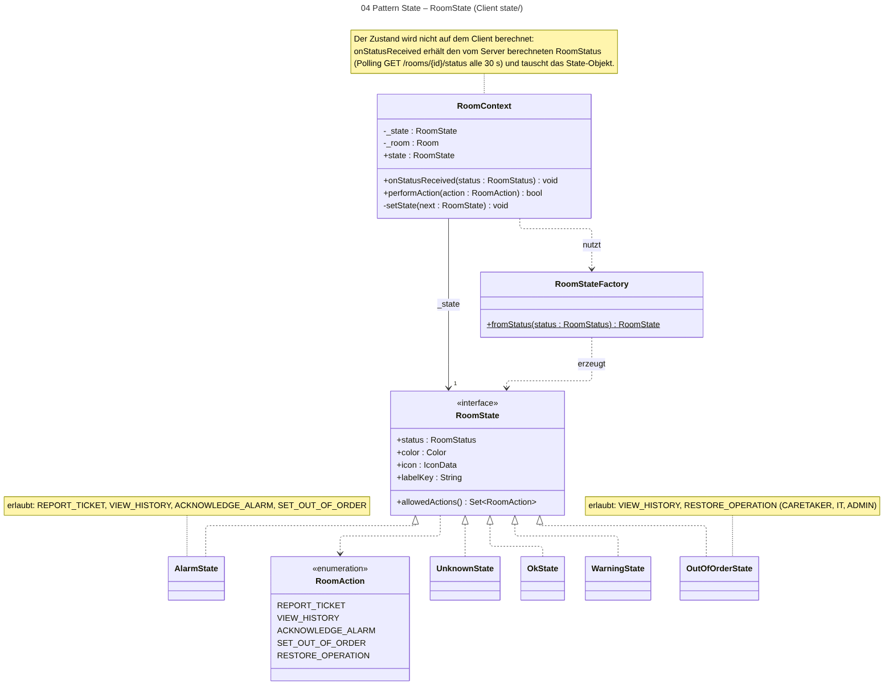

State: Der `RoomContext` hält den aktuellen `RoomState` (Ok, Warning, Alarm, OutOfOrder, Unknown). Jeder Zustand legt Farbe, Icon und erlaubte Aktionen fest.

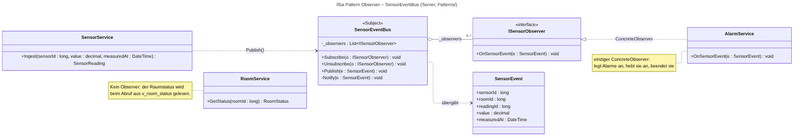

Observer (Server): `SensorService` meldet neue Messwerte an den `SensorEventBus`, der `AlarmService` ist als Beobachter registriert und prüft die Grenzwerte.

### Use-Case-Diagramm

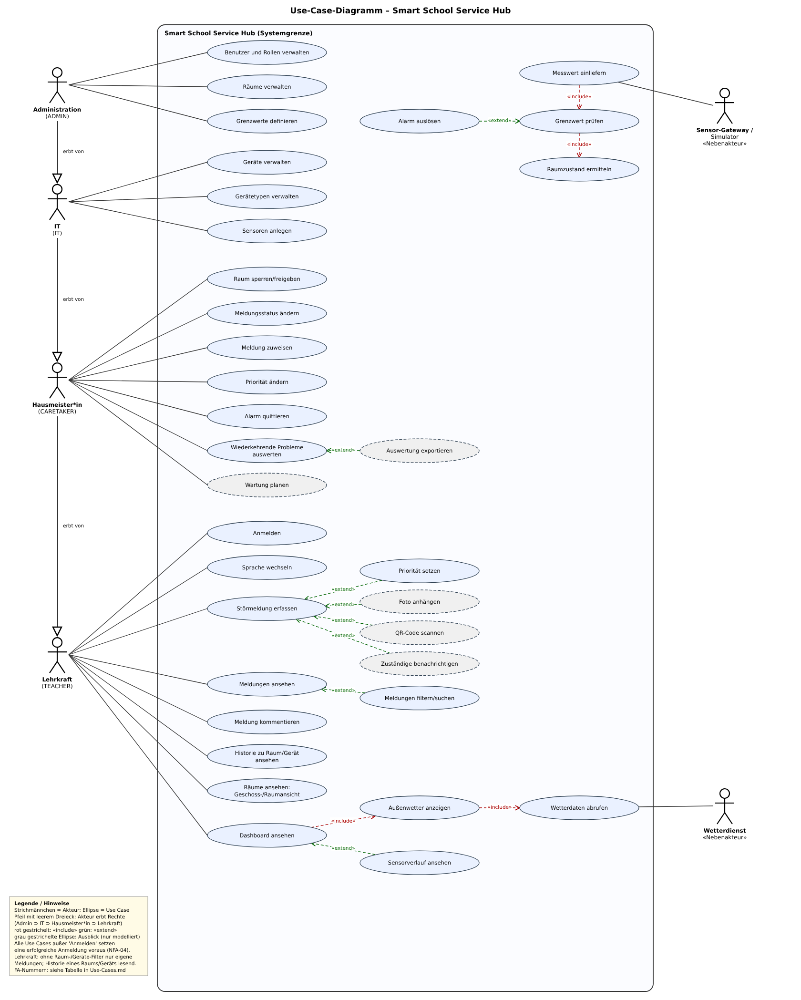

Akteure sind Lehrkraft, Hausmeister*in, IT und Administration (jeweils mit den Rechten der darunterliegenden Rolle) sowie Sensor-Gateway und Wetterdienst als Nebenakteure. Gestrichelte graue Use Cases sind nur als Ausblick modelliert.

### Paketdiagramme

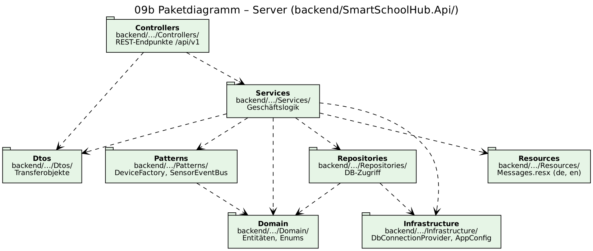

Server: Controllers rufen Services auf, Services nutzen Repositories, diese greifen auf die Datenbank zu. `Domain` hängt von nichts ab.

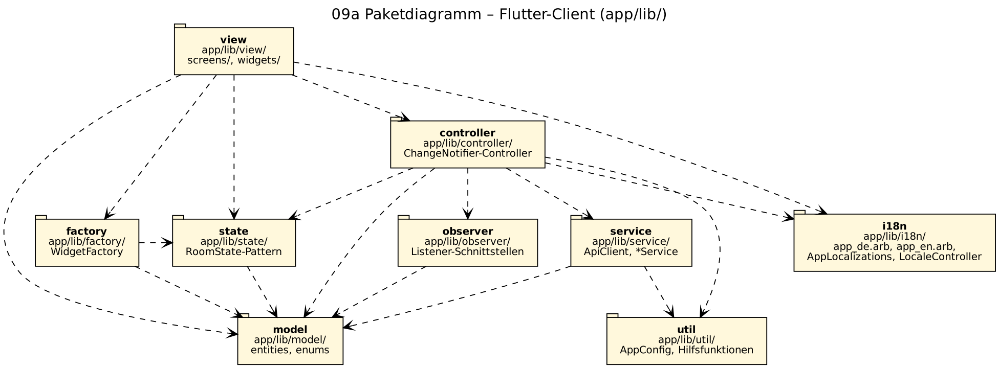

Client: `view` → `controller` → `service`; `model` wird von allen Schichten genutzt, `state`, `observer` und `factory` enthalten die Patterns.

### Aktivitätsdiagramme

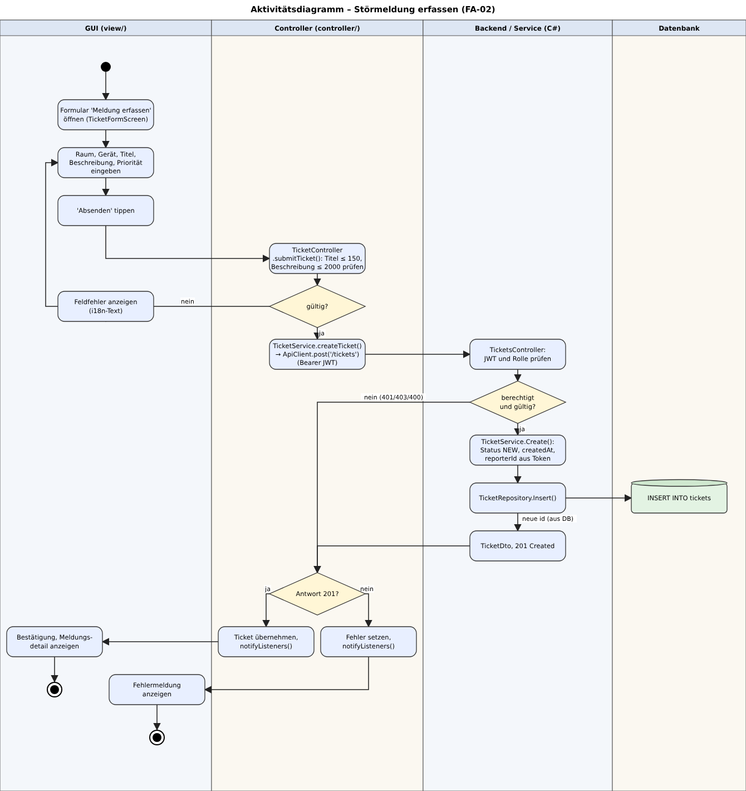

Meldung erfassen mit Bahnen für GUI, Controller, Backend und Datenbank, inklusive Prüfung der Eingaben und Fehlerfall.

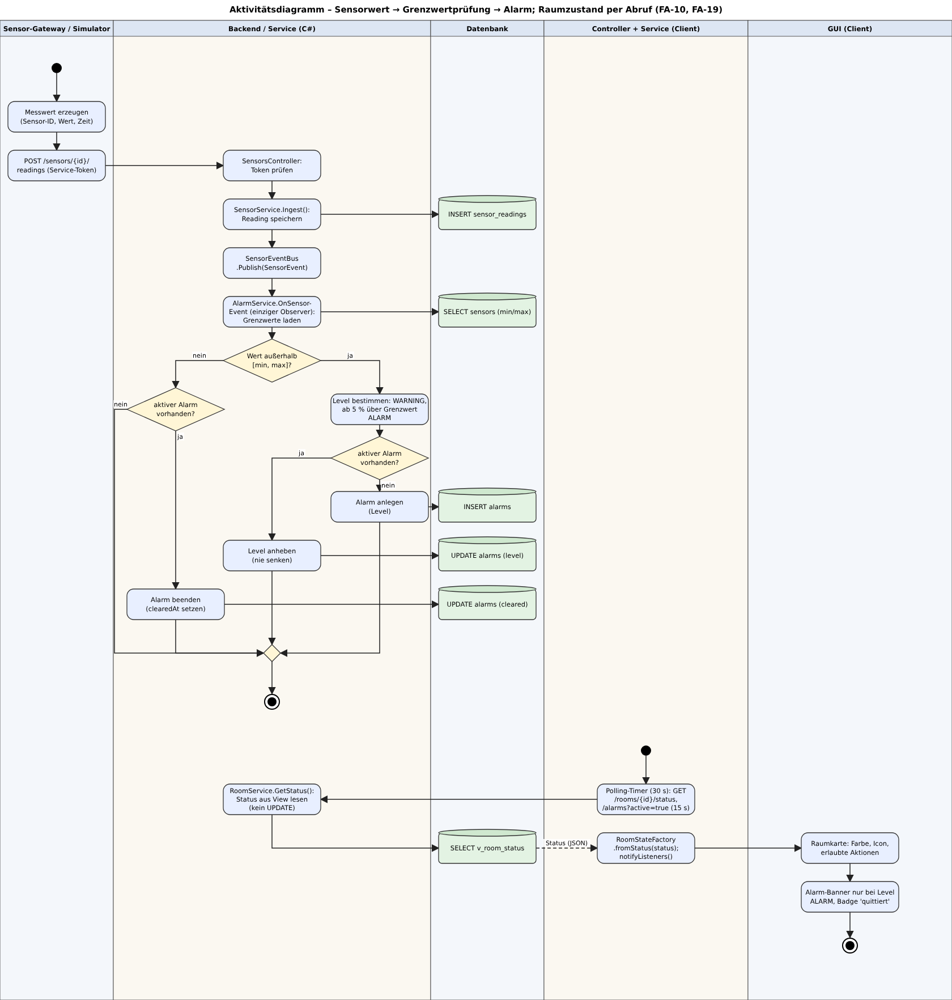

Messwert → Grenzwertprüfung → Alarm anlegen, anheben oder beenden. Der Raumstatus wird beim Abruf aus der View gelesen.

### Zustandsdiagramme

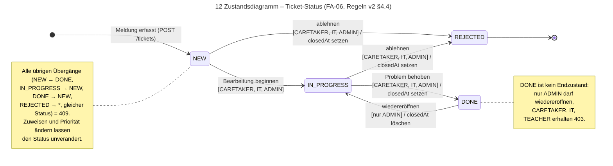

Status einer Meldung: NEW → IN_PROGRESS → DONE, ablehnen (REJECTED) ist aus NEW und IN_PROGRESS möglich. Wiedereröffnen darf nur die Administration.

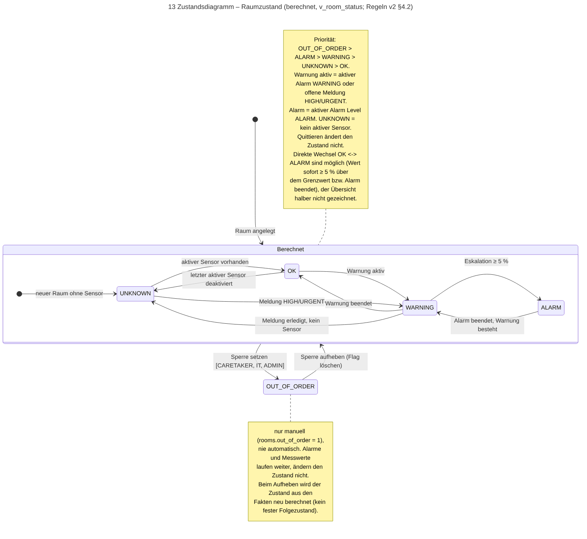

Raumzustand (berechnet): OUT_OF_ORDER vor ALARM vor WARNING vor UNKNOWN vor OK. Nur OUT_OF_ORDER wird manuell gesetzt.

### Sequenzdiagramm

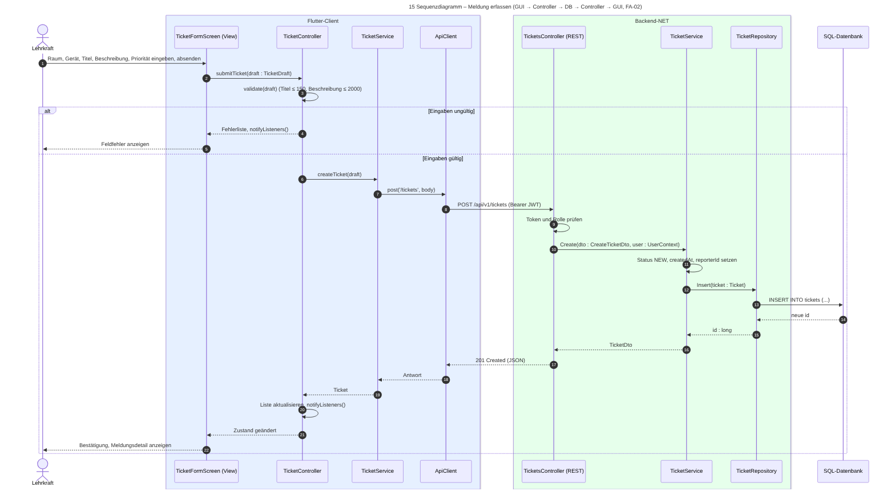

Meldung erfassen von der GUI über Controller, Service und REST-Schnittstelle bis zur Datenbank und zurück.

## 2 Design-Patterns

| Pattern | Wo | Wofür |
|---|---|---|
| MVC | Client: `view/`, `controller/`, `model/`, `service/` | Oberfläche, Logik und Daten trennen |
| Observer | Server: `SensorEventBus`; Client: `ChangeNotifier` | Alarmprüfung bei neuen Messwerten; Oberfläche aktualisiert sich bei Datenänderung |
| State | Client: `state/` (`RoomState`) | Darstellung und erlaubte Aktionen je Raumzustand ohne viele if/else |
| Factory | Server: `DeviceFactory`; Client: `WidgetFactory` | passendes Geräteprofil bzw. passende Gerätekarte je Gerätetyp erzeugen |
| Singleton | `ApiClient`, `LocaleController`, `DbConnectionProvider`, `AppConfig` | genau eine Instanz für HTTP-Client, Sprache, DB-Verbindung und Konfiguration |
| Repository | Server: `Repositories/` | SQL an einer Stelle bündeln, Services kennen nur das Interface |

## 3 Paketstruktur

Client (Flutter, `app/lib/`):

```
app/lib/
├── model/        Entitäten und Enums (User, Room, Ticket, ...)
├── view/
│   ├── screens/  Bildschirme (LoginScreen, DashboardScreen, ...)
│   └── widgets/  wiederverwendbare Widgets (RoomCard, AlarmBanner, ...)
├── controller/   ChangeNotifier-Controller (TicketController, ...)
├── service/      ApiClient und fachliche Services (REST-Aufrufe)
├── state/        State-Pattern für den Raumzustand
├── observer/     Listener-Schnittstellen
├── factory/      WidgetFactory
├── i18n/         Sprachdateien (de, en) und LocaleController
└── util/         Hilfsfunktionen (Datumsformat, Validierung)
```

Server (C#, `backend/SmartSchoolHub.Api/`):

```
backend/SmartSchoolHub.Api/
├── Controllers/     REST-Endpunkte unter /api/v1
├── Services/        Geschäftslogik (Tickets, Sensoren, Alarme, Raumstatus)
├── Repositories/    Datenbankzugriff (SQL)
├── Domain/          Entitäten und Enums
├── Dtos/            Transferobjekte für die API
├── Patterns/        DeviceFactory, SensorEventBus
├── Infrastructure/  DbConnectionProvider, AppConfig
└── Resources/       Meldungstexte (de, en)
```

## 4 Verantwortlichkeiten

| Paket / Modul | Aufgabe | Verantwortlich |
|---|---|---|
| Client `view/` | Screens und Widgets, responsives Layout | Name eintragen |
| Client `controller/`, `service/` | Zustandslogik, REST-Anbindung | Name eintragen |
| Client `model/`, `state/`, `observer/`, `factory/` | Entitäten und Patterns im Client | Name eintragen |
| Client `i18n/` | Sprachdateien, Sprachwechsel | Name eintragen |
| Server `Controllers/`, `Dtos/` | REST-Schnittstelle, Rechteprüfung | Name eintragen |
| Server `Services/`, `Patterns/` | Geschäftslogik, Alarmprüfung, Factory, Observer | Name eintragen |
| Server `Domain/`, `Repositories/`, `Infrastructure/` | Entitäten, SQL-Zugriff, Verbindung | Name eintragen |
| Datenbank (`schema.sql`, `seed.sql`) | Schema, Constraints, Testdaten | Name eintragen |
| Dokumentation und Tests | Diagramme pflegen, Tests, Review | Name eintragen |

## 5 Use Cases (Kurzfassung)

| Use Case | Akteur |
|---|---|
| Anmelden, Sprache wechseln | alle Rollen |
| Störmeldung erfassen | Lehrkraft (und höher) |
| Meldungen ansehen, filtern, kommentieren | alle Rollen |
| Räume und Geschosse ansehen, Dashboard ansehen | alle Rollen |
| Meldungsstatus ändern, Meldung zuweisen, Priorität ändern | Hausmeister*in, IT, Administration |
| Raum sperren/freigeben, Alarm quittieren | Hausmeister*in, IT, Administration |
| Geräte, Gerätetypen und Sensoren verwalten | IT, Administration |
| Benutzer, Räume und Grenzwerte verwalten | Administration |
| Messwert einliefern | Sensor-Gateway / Simulator |
| Außenwetter abrufen | Wetterdienst |
