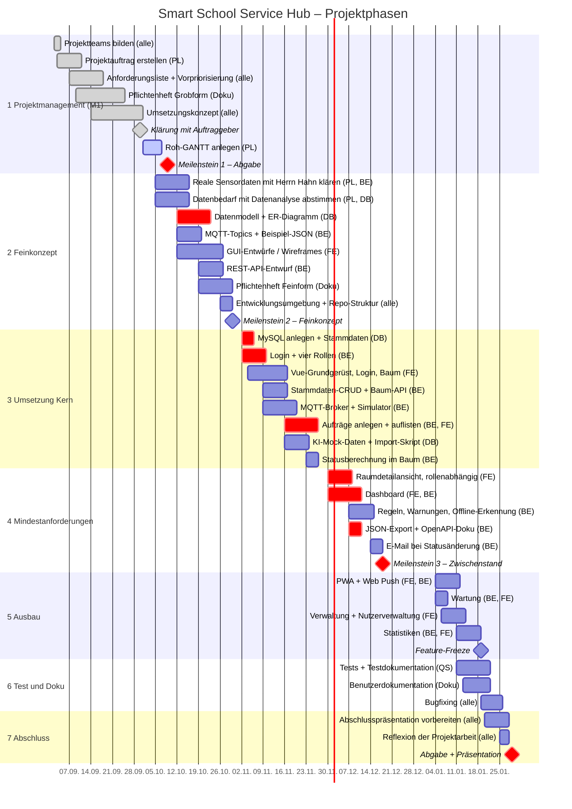

# GANTT-Diagramm (Roh-Planung)

## Projekt „Smart School Service Hub"

**Stand:** 02.10.2026 · **Version:** 0.1 · **Bezug:** [02_Pflichtenheft.md](02_Pflichtenheft.md),
[03_Umsetzungskonzept.md](03_Umsetzungskonzept.md) (Kap. 14 Umsetzungsreihenfolge)

> **Roh-GANTT für Meilenstein 1.** Die Aufgabenstellung verlangt: *„Was kommt wann und wer
> kümmert sich?"* Die Termine sind eine **grobe Vorhersage**. Offizielle Meilenstein-Termine
> stehen noch aus (OP-6), ebenso die Ferien. Beides wird nachgetragen, sobald es bekannt
> ist. Alle Daten nach dem 09.10.2026 sind **Annahmen**.

---

## 1 Diagramm

Als Bild für die Abgabe: [04_GANTT.png](04_GANTT.png)

**Legende:** grau = erledigt · hervorgehoben = in Arbeit · rot = kritischer Pfad bzw.
Mindestanforderung der Aufgabenstellung · Raute = Meilenstein

---

## 2 Wer kümmert sich?

Im Diagramm stehen **Rollen** statt Namen, weil die Teambeschreibung (Pflichtenheft
Kap. 1) noch aussteht. Sobald sie steht, hier die Namen eintragen:

| Kürzel | Rolle | Verantwortlich für | Name |
|--------|-------|--------------------|------|
| PL | Projektleitung | Planung, Termine, Abstimmung mit Auftraggeber, Herrn Hahn und der Datenanalyse | _[eintragen]_ |
| FE | Frontend | Vue, PWA, Screens, Diagramme | _[eintragen]_ |
| BE | Backend | C#-API, MQTT-Worker, Regeln, E-Mail/Push | _[eintragen]_ |
| DB | Datenbank | MySQL-Datenmodell, ER-Diagramm, Mock-Daten, Export | _[eintragen]_ |
| QS / Doku | Qualitätssicherung + Dokumentation | Pflichtenheft, Tests, Benutzerdokumentation | _[eintragen]_ |

---

## 3 Phasen und Bezug zum Pflichtenheft

| Phase | Zeitraum *(Annahme)* | Ergebnis | Anforderungen |
|-------|----------------------|----------|---------------|
| 1 Projektmanagement | 02.09. – 09.10.2026 | Projektauftrag, Anforderungsliste, Pflichtenheft (Grobform), Roh-GANTT | Meilenstein 1 |
| 2 Feinkonzept | 05.10. – 30.10.2026 | ER-Diagramm, MQTT-Topics, API-Entwurf, Wireframes, Pflichtenheft (Feinform) | NFA-02, NFA-11, NFA-12, FA-33 |
| 3 Umsetzung Kern | 02.11. – 27.11.2026 | Login, Baum, Aufträge, Sensordaten fließen | FA-01 – FA-08, FA-22 – FA-27, FA-36 |
| 4 Mindestanforderungen | 30.11. – 18.12.2026 | **alle Mindestanforderungen** lauffähig | FA-11, FA-16, FA-28, FA-29, FA-32, FA-35 |
| 5 Ausbau | 04.01. – 19.01.2027 | PWA/Push, Wartung, Verwaltung, Statistiken | FA-13, FA-30, FA-34, NFA-08 |
| 6 Test und Doku | 11.01. – 26.01.2027 | Testdokumentation, Benutzerdokumentation | Projektergebnisse |
| 7 Abschluss | 20.01. – 29.01.2027 | Abschlusspräsentation, Reflexion | Projektergebnisse |

**Planungslogik:**

- **Kritischer Pfad:** Datenmodell → Datenbank → Login/Rollen → Aufträge →
  Raumdetail/Dashboard. Verzögert sich einer dieser Schritte, verschiebt sich der
  Zwischenstand.
- **Meilenstein 3 vor den Weihnachtsferien:** Bis dahin sollen alle Mindestanforderungen
  der Aufgabenstellung erfüllt sein (Umsetzungskonzept Kap. 13). Alles danach ist Ausbau
  und Puffer.
- **Frühe Abstimmungen:** Mit Herrn Hahn (reale Sensordaten) und mit der Daten- und
  Prozessanalyse (Datenbedarf) wird **vor** dem Datenmodell gesprochen. Nachträgliche
  Felder bedeuten Migration und neue Mock-Daten.
- **Parallel arbeiten:** Frontend und Backend laufen ab Phase 3 parallel. Das Frontend
  kann mit Beispiel-JSON arbeiten, bis die API steht.

## 4 Offen

- Offizielle Meilenstein-Termine des Auftraggebers (OP-6). Die Termine für M2, M3 und die
  Abgabe sind geschätzt.
- Herbst- und Weihnachtsferien eintragen. Bisher ist nur angenommen, dass zwischen dem
  18.12.2026 und dem 04.01.2027 nicht gearbeitet wird.
- Namen in Kapitel 2 eintragen, sobald die Teambeschreibung steht.
